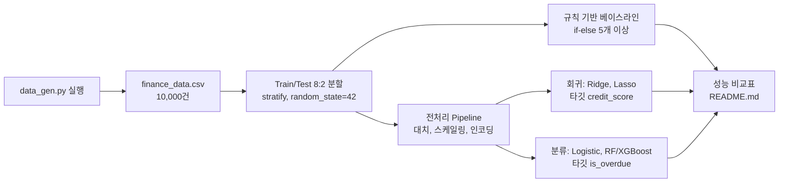
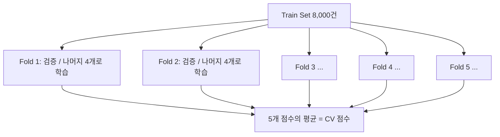
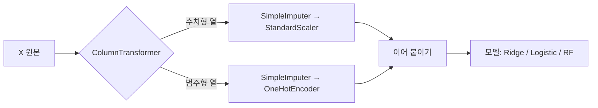

# A5-1 개념 정리 — 지도학습 파이프라인: 규칙 기반 vs 머신러닝, 회귀와 분류

대상: Python과 pandas는 써 봤지만 머신러닝은 처음인 학습자<br>
기준 과제: [A5-1 과제 원문(subject.md)](../subject.md)<br>
함께 볼 문서: [A5-1 단계별 실습 가이드(WALKTHROUGH.md)](WALKTHROUGH.md)

이 문서는 과제를 푸는 데 필요한 개념을 설명합니다. 코드를 어떤 순서로 작성하는지는 [WALKTHROUGH.md](WALKTHROUGH.md)에서 다룹니다. 여기서는 "왜 그렇게 해야 하는가"를 이해하는 것이 목표입니다. 개념마다 일상 비유 → 정확한 정의 → 손으로 계산하는 작은 예제 → 과제와의 연결 → 흔한 오해 순서로 설명합니다.

## 읽는 순서

| 순서 | 배울 내용 | 이걸 알면 할 수 있는 일 |
| --- | --- | --- |
| 1 | 지도학습, 특성과 타깃, 회귀와 분류 | `finance_data.csv`의 어떤 열이 입력이고 어떤 열이 정답인지 구분하기 |
| 2 | 규칙 기반 베이스라인 | if-else 규칙 5개 이상으로 비교 기준 모델 만들기 |
| 3 | 데이터 분할, 층화, 재현성, 교차 검증 | 8:2 층화 분할과 `random_state=42`의 의미 설명하기 |
| 4 | 데이터 누수 | "fit은 Train Set에서만"이 왜 필수인지 설명하기 |
| 5 | 전처리: 대치, 스케일링, 인코딩 | 결측치 채우기, 표준화, 원-핫 인코딩 적용하기 |
| 6 | Pipeline과 ColumnTransformer | 전처리와 모델을 한 객체로 묶어 누수 없이 학습하기 |
| 7 | 선형 회귀와 회귀 지표 | RMSE, MAE, R²를 계산하고 해석하기 |
| 8 | 과대적합과 규제(Ridge, Lasso) | Alpha별 계수 변화 그래프를 읽고 설명하기 |
| 9 | 로지스틱 회귀와 확률 | 연체 확률(0~1)을 출력하는 모델 이해하기 |
| 10 | 분류 지표와 Confusion Matrix | Accuracy, Precision, Recall, F1을 손으로 계산하기 |
| 11 | 임계값, ROC 곡선, AUC | ROC-AUC 그래프를 그리고 AUC 값을 해석하기 |
| 12 | 데이터 불균형: class_weight, SMOTE | 연체 12% 데이터에서 소수 클래스를 놓치지 않게 하기 |
| 13 | 결정 트리, Random Forest, XGBoost | 앙상블이 단일 모델보다 강한 이유 설명하기 |
| 14 | GridSearchCV | 하이퍼파라미터 조합을 교차 검증으로 고르기 |
| 15 | 편향-분산과 Learning Curve(보너스) | 데이터 양에 따른 성능 곡선 해석하기 |
| 16 | 커스텀 Transformer(보너스) | `BaseEstimator`를 상속한 전처리 클래스 만들기 |
| 17 | 재현성과 형상 관리 | `requirements.txt`, `.gitignore`, 기능 단위 커밋 관리하기 |

1~6은 모든 모델에 공통으로 필요한 기반입니다. 7~8은 회귀 과제, 9~12는 분류 과제, 13~14는 앙상블 과제에 해당합니다. 처음 읽을 때는 1~6을 먼저 확실히 이해하는 것을 권장합니다.

## 0. 과제 전체 그림



같은 고객 데이터로 **두 가지 질문**을 던진다는 점이 핵심입니다.

- 회귀 질문: "이 고객의 신용 점수는 몇 점일까?" → 숫자를 맞힘
- 분류 질문: "이 고객은 연체할까, 안 할까?" → 범주를 맞힘

질문이 바뀌면 모델, 평가 지표, 해석 방법이 모두 달라집니다. 이 차이를 체감하는 것이 과제의 핵심 목표입니다.

## 1. 지도학습, 특성과 타깃, 회귀와 분류

### 비유

수학 문제집을 풀 때 뒤쪽 해답지를 보며 공부하는 것과 같습니다. 문제(입력)와 해답(정답)이 짝지어진 예시를 많이 보면, 처음 보는 문제도 풀 수 있게 됩니다. 이렇게 **정답이 붙은 데이터로 배우는 방식**을 지도학습(Supervised Learning)이라고 합니다.

### 정의

- **특성(Feature, X)**: 예측에 사용하는 입력 변수
- **타깃(Target, y)**: 맞히려는 정답 변수
- **회귀(Regression)**: 타깃이 연속적인 숫자일 때 (예: 신용 점수 375점)
- **분류(Classification)**: 타깃이 정해진 범주일 때 (예: 연체 1 / 정상 0)

### 과제 데이터의 열 구분

`data_gen.py`가 만드는 `finance_data.csv`의 열은 다음과 같습니다.

| 열 이름 | 의미 | 역할 |
| --- | --- | --- |
| `age` | 나이(20~69) | 특성 |
| `annual_income` | 연 소득(만원, 최솟값 1500으로 보정) | 특성 |
| `spending_score` | 소비 점수(1~99) | 특성 |
| `debt_ratio` | 소득 대비 부채 비율(0~1) | 특성 |
| `credit_card_count` | 보유 신용카드 수(1~9) | 특성 |
| `overdue_count_6m` | 최근 6개월 연체 횟수 | 특성 |
| `credit_score` | 신용 점수 | **회귀 타깃** |
| `is_overdue` | 연체 여부(1=연체) | **분류 타깃** |

과제 원문의 "6개 변수"가 위의 특성 6개입니다.

### 생성 코드를 읽으면 보이는 것

생성 코드는 정답이 만들어지는 규칙을 그대로 보여 줍니다.

$$\text{credit\_score} = 300 + 0.03 \times \text{income} - 50 \times \text{overdue} - 100 \times \text{debt} + \text{noise}$$

- 신용 점수는 `annual_income`, `overdue_count_6m`, `debt_ratio` 세 변수와 **선형 관계**입니다. `age`, `spending_score`, `credit_card_count`는 점수에 아무 영향이 없습니다. 이 사실은 뒤에서 Lasso가 어떤 계수를 0으로 만드는지 해석할 때 중요합니다.
- `is_overdue`는 신용 점수가 하위 15% 미만인 고객 중 약 80%만 1로 정해집니다. 그래서 연체 비율은 약 12% 내외로 **불균형**합니다.

### 흔한 오해

- "타깃 열도 특성으로 넣으면 더 잘 맞힌다" — 맞기는 하지만 반칙입니다. `is_overdue`는 `credit_score`로부터 직접 만들어졌으므로, 분류 모델에 `credit_score`를 입력으로 넣으면 정답을 거의 그대로 알려 주는 셈입니다. 실제 대출 심사 시점에는 알 수 없는 값을 쓰는 것도 데이터 누수의 한 형태입니다(4장). 두 타깃 열은 두 모델 모두에서 특성에서 제외합니다.
- "회귀 = 선형 회귀" — 회귀는 문제 유형의 이름입니다. Random Forest로도 회귀를 할 수 있고, 반대로 이름에 '회귀'가 들어간 로지스틱 회귀는 분류 모델입니다.

## 2. 규칙 기반 베이스라인

### 비유

새 내비게이션 앱이 좋은지 판단하려면 "그냥 늘 다니던 길로 가는 것"과 비교해야 합니다. 비교 대상이 없으면 "정확도 85%"가 좋은 건지 나쁜 건지 알 수 없습니다. 이 비교 기준이 **베이스라인(Baseline)** 입니다.

### 정의

규칙 기반 모델은 사람이 경험으로 정한 if-else 조건으로 예측합니다. 데이터로부터 아무것도 학습하지 않습니다. 과제는 **최소 5개 이상의 규칙**을 요구합니다.

```python
def rule_based_predict(row):
    if row["overdue_count_6m"] >= 3:
        return 1
    # TODO: 규칙을 4개 이상 더 추가
    return 0
```

### 규칙 모델의 장점과 한계

| 관점 | 규칙 기반 | 머신러닝 |
| --- | --- | --- |
| 설명 | 매우 쉬움("연체 3회 이상이면 거절") | 모델에 따라 어려움 |
| 기준값 결정 | 사람이 감으로 정함(0.7? 0.8?) | 데이터로 최적화 |
| 변수 조합 | 조건이 늘면 관리가 어려움 | 여러 변수를 동시에 고려 |
| 확률 출력 | 보통 0/1만 출력 | 0~1 확률 출력 가능 |

### 규칙 모델과 AUC

AUC(11장)는 "점수가 높은 순서대로 줄 세웠을 때 얼마나 잘 정렬되는가"를 봅니다. 규칙 모델이 0/1만 출력하면 줄 세우기가 두 단계뿐이라 ROC 곡선이 꺾인 선 하나가 됩니다. 이때 AUC는 다음과 같습니다.

$$\text{AUC}_{0/1} = \frac{\text{TPR} + (1 - \text{FPR})}{2}$$

비교표에 AUC를 넣으려면 두 가지 방법이 있습니다. (1) 0/1 예측으로 그대로 계산하고 그 사실을 README에 적는다, (2) "해당되는 규칙 개수"처럼 위험 점수를 만들어 계산한다. 어느 쪽을 택했는지 명시하는 것을 권장합니다.

### 흔한 오해

- "베이스라인은 일부러 나쁘게 만들어도 된다" — 비교가 의미 있으려면 최선을 다한 규칙이어야 합니다. 생성 코드를 보면 어떤 변수가 실제로 중요한지 알 수 있으니, 규칙을 합리적으로 설계해 보세요. 그래도 ML이 이기는지 확인하는 것이 과제의 질문입니다.

## 3. 데이터 분할, 층화, 재현성, 교차 검증

### 비유

시험 문제를 미리 보고 공부한 학생의 점수는 실력이 아닙니다. 모델도 학습에 쓴 데이터로 평가하면 실력을 과대평가합니다. 그래서 데이터를 **Train(공부용)** 과 **Test(시험용)** 로 나눕니다.

### 정의

- **Train/Test 분할**: 과제 기준은 8:2입니다. 10,000건이면 8,000건 학습, 2,000건 평가입니다.
- **층화 분할(Stratified Split)**: 나누기 전과 후의 클래스 비율을 똑같이 유지합니다. `train_test_split(..., stratify=y)`로 지정합니다.
- **random_state=42**: 무작위 섞기의 시작점을 고정합니다. 같은 코드를 다시 실행하면 같은 분할이 나옵니다. 과제에서 **고정 필수**입니다.

### 손으로 보는 층화의 효과

연체 비율이 12%인 10,000건을 2,000건 Test로 뽑는다고 합시다.

- 층화를 하면: Test에 연체가 정확히 약 240건(12%) 들어갑니다.
- 층화를 안 하면: 운에 따라 200건(10%)이 될 수도, 280건(14%)이 될 수도 있습니다. 소수 클래스가 적을수록 이 흔들림이 지표를 크게 바꿉니다.

### 교차 검증(Cross-Validation)

Test Set은 마지막 시험이므로, 모델을 고르는 과정에서 들여다보면 안 됩니다. 대신 Train Set 안에서 다시 나눠 연습 시험을 봅니다.



5-fold는 Train을 5등분해서, 한 조각씩 돌아가며 검증용으로 쓰고 나머지 4조각으로 학습합니다. 과제는 **5-fold를 권장**합니다. 분류에서 scikit-learn은 기본적으로 층화된 K-Fold(`StratifiedKFold`)를 사용합니다.

### 흔한 오해

- "CV를 했으니 Test Set은 필요 없다" — CV 점수로 하이퍼파라미터를 골랐다면, 그 점수는 이미 선택 과정에 쓰였습니다. 최종 보고는 한 번도 쓰지 않은 Test Set으로 합니다.

## 4. 데이터 누수(Data Leakage)

### 비유

시험 전날 선생님이 "이번 시험 평균은 72점이고 최고점은 98점이야"라고 알려 줬다면, 문제 자체를 보지 않았어도 시험에 관한 정보가 새어 나온 것입니다. 모델에게 Test Set의 정보가 조금이라도 들어가는 것을 **데이터 누수**라고 합니다.

### 정의와 대표 사례

| 누수 유형 | 예시 | 이 과제에서 |
| --- | --- | --- |
| 전처리 누수 | 전체 데이터로 평균/표준편차를 구해 스케일링 | 스케일러를 분할 전에 fit하면 발생 |
| 리샘플링 누수 | 분할 전에 SMOTE로 가짜 샘플 생성 | SMOTE는 Train에서만 |
| 타깃 누수 | 정답에서 파생된 변수를 입력으로 사용 | `credit_score`로 `is_overdue` 예측 |
| CV 내부 누수 | CV 전에 Train 전체로 스케일러 fit | Pipeline으로 해결 |

### 손으로 보는 전처리 누수

Train에 소득 `[2000, 4000, 6000]`, Test에 `[10000]`이 있다고 합시다.

- 올바른 방법: Train만으로 평균 $\mu = 4000$을 구합니다. Test의 10000은 Train 기준으로 "매우 큰 값"으로 변환됩니다. 실제 서비스에서 처음 보는 고객도 이렇게 처리됩니다.
- 누수: 네 값 전체 평균 $\mu = 5500$을 구합니다. Test 값의 존재가 Train 변환에 영향을 줬습니다. 모델은 미래 고객의 분포를 미리 엿본 셈입니다.

이 데이터에서는 차이가 작게 나올 수 있지만, 원칙을 어기면 실제 서비스 성능을 과대평가하게 됩니다. 과제는 이를 명시적으로 요구합니다: **전처리/SMOTE/스케일링은 반드시 Train Set에서만 fit**.

### fit, transform, fit_transform

| 메서드 | 하는 일 | 어디에 쓰나 |
| --- | --- | --- |
| `fit(X)` | 데이터에서 규칙(평균, 범주 목록 등)을 배움 | Train만 |
| `transform(X)` | 배운 규칙으로 변환 | Train, Test 모두 |
| `fit_transform(X)` | 둘을 한 번에 | Train만 |

Test에 `fit_transform`을 쓰면 누수입니다. 이 실수를 구조적으로 막는 도구가 6장의 Pipeline입니다.

## 5. 전처리: 대치, 스케일링, 인코딩

### 5.1 결측치 대치(Imputation)

**비유**: 설문지에 빈칸이 있으면 버리기보다 "비슷한 사람들의 대표값"으로 채웁니다.

**정의**: `SimpleImputer(strategy="median")`은 Train의 각 열 중앙값을 기억했다가 빈칸(NaN)을 그 값으로 채웁니다. 중앙값은 극단값에 덜 흔들려서 평균보다 안전한 경우가 많습니다.

**예시**: Train 소득 `[2000, 3000, NaN, 100000]` → 중앙값 3000으로 채움. 평균(35000)으로 채웠다면 이상치 하나 때문에 큰 값이 들어갔을 것입니다.

**이 데이터에서**: 생성 코드는 결측치를 만들지 않습니다. 그래도 과제는 "수치형 변수는 대치 후 스케일링"을 요구하므로 Pipeline에 대치 단계를 넣어야 합니다. 실제 서비스에 들어올 새 데이터에는 빈칸이 있을 수 있다는 점에서 의미가 있습니다.

### 5.2 스케일링(Scaling)

**비유**: 키(cm)와 몸무게(kg)를 그대로 더하면 숫자가 큰 키가 결과를 좌우합니다. 단위를 맞춰야 공정하게 비교할 수 있습니다.

**정의(표준화, StandardScaler)**:

$$z = \frac{x - \mu}{\sigma}$$

$\mu$는 Train 평균, $\sigma$는 Train 표준편차입니다. 변환 후 각 열은 평균 0, 표준편차 1이 됩니다.

**손 계산**: 소득 Train 평균 5000, 표준편차 2000이라면

- 소득 7000 → $z = (7000-5000)/2000 = 1.0$
- 소득 3000 → $z = (3000-5000)/2000 = -1.0$

부채 비율(0~1)과 소득(1500~12000)이 같은 눈금으로 맞춰집니다.

**왜 중요한가**: Ridge와 Lasso는 계수 크기에 벌점을 줍니다(8장). 스케일이 다르면 단위가 작은 변수일수록 계수가 커져서 부당하게 벌점을 받습니다. 또 계수 변화 그래프에서 변수끼리 비교하려면 같은 눈금이어야 합니다. 반면 트리 모델은 "값이 기준보다 큰가"만 보기 때문에 스케일링이 결과에 거의 영향을 주지 않습니다.

### 5.3 범주형 인코딩(Encoding)

**비유**: 컴퓨터는 "서울/부산/대구"를 계산할 수 없으므로 숫자로 바꿔야 합니다. 그런데 서울=1, 부산=2, 대구=3으로 바꾸면 "대구가 서울의 3배"라는 엉뚱한 의미가 생깁니다.

**원-핫 인코딩(One-Hot Encoding)**: 범주마다 열을 하나씩 만들고 해당하면 1, 아니면 0을 넣습니다.

| 지역 | 지역_서울 | 지역_부산 | 지역_대구 |
| --- | --- | --- | --- |
| 서울 | 1 | 0 | 0 |
| 대구 | 0 | 0 | 1 |

`OneHotEncoder(handle_unknown="ignore")`를 쓰면 Test에 Train에서 못 본 범주가 나와도 오류 없이 모두 0으로 처리합니다.

**이 데이터에서 주의**: 생성된 6개 특성은 모두 숫자형이고 문자열 범주 열이 없습니다. 과제는 "범주형 변수는 인코딩"을 요구하므로, 어떤 열을 범주형으로 다룰지 직접 결정하고 근거를 README에 적어야 합니다. 선택지는 다음과 같습니다.

| 선택지 | 내용 | 고려할 점 |
| --- | --- | --- |
| 이산형 열을 범주로 취급 | 값 종류가 적은 정수 열(`credit_card_count` 1~9, `overdue_count_6m` 0~4)을 원-핫 인코딩 | 순서 정보가 사라짐. 연체 횟수처럼 "많을수록 위험"인 변수는 수치형이 더 자연스러울 수 있음 |
| 파이프라인 안에서 구간화 | 예: 나이를 연령대 범주로 바꾸는 변환 단계를 추가 | CSV 자체는 수정하지 않으므로 "데이터를 임의로 수정하지 않는다"와 충돌하지 않음. 보너스 1(Custom Transformer)과 연결 가능 |

어느 쪽이든 **CSV 파일 자체는 수정하지 않는다**는 조건을 지켜야 합니다.

## 6. Pipeline과 ColumnTransformer

### 비유

공장의 컨베이어 벨트입니다. 원재료(원본 데이터)를 넣으면 세척(대치) → 규격화(스케일링) → 조립(모델) 순서로 자동 처리됩니다. 공정 순서를 사람이 매번 기억할 필요가 없고, 순서를 바꾸는 실수도 생기지 않습니다.

### 정의

- **Pipeline**: 여러 단계를 순서대로 연결한 하나의 추정기입니다. `pipe.fit(X_train, y_train)`을 호출하면 각 전처리 단계가 Train으로 `fit_transform`되고 마지막 모델이 학습됩니다. `pipe.predict(X_test)`를 호출하면 전처리 단계는 `transform`만 합니다. 누수가 구조적으로 막힙니다.
- **ColumnTransformer**: 열 그룹마다 다른 전처리를 적용하고 결과를 옆으로 이어 붙입니다.



### 모양만 보는 예시

```python
numeric = Pipeline([("imputer", SimpleImputer(strategy="median")),
                    ("scaler", StandardScaler())])
preprocess = ColumnTransformer([("num", numeric, num_cols),
                                ("cat", ..., cat_cols)])   # TODO
model = Pipeline([("prep", preprocess), ("clf", ...)])      # TODO
```

### Pipeline이 교차 검증에서 특히 중요한 이유

`cross_val_score(model, X_train, y_train, cv=5)`에 Pipeline을 넘기면, **각 fold마다** 스케일러가 그 fold의 학습 부분에서만 새로 fit됩니다. Pipeline 없이 미리 스케일링한 데이터를 넘기면 검증 fold의 정보가 이미 스며든 상태가 됩니다.

### 파라미터 이름 규칙

Pipeline 안의 단계 파라미터는 `단계이름__파라미터` 형식으로 접근합니다. 예: `clf__alpha`, `clf__n_estimators`. GridSearchCV(14장)에서 이 이름을 씁니다. 밑줄이 **두 개**라는 점에 주의하세요.

## 7. 선형 회귀와 회귀 지표

### 직관

선형 회귀는 "점수 = 기본점 + 소득 × a + 부채 × b + ..."의 a, b를 데이터에 가장 잘 맞게 정하는 방법입니다.

$$\hat{y} = w_0 + w_1 x_1 + w_2 x_2 + \dots + w_p x_p$$

$w$를 **계수(coefficient)** 또는 가중치라고 합니다. "가장 잘 맞게"는 오차 제곱합을 최소로 한다는 뜻입니다.

### 회귀 지표

$n$개 샘플의 실제값 $y_i$, 예측값 $\hat{y}_i$에 대해

$$\text{MAE} = \frac{1}{n}\sum_{i=1}^{n} \lvert y_i - \hat{y}_i \rvert$$

$$\text{RMSE} = \sqrt{\frac{1}{n}\sum_{i=1}^{n} (y_i - \hat{y}_i)^2}$$

$$R^2 = 1 - \frac{\sum (y_i - \hat{y}_i)^2}{\sum (y_i - \bar{y})^2}$$

| 지표 | 의미 | 단위 | 좋은 방향 |
| --- | --- | --- | --- |
| MAE | 평균적으로 몇 점 틀리는가 | 점수와 같음 | 작을수록 |
| RMSE | 큰 오차에 더 큰 벌점 | 점수와 같음 | 작을수록 |
| R² | "평균으로 찍기" 대비 얼마나 잘 설명하는가 | 없음(보통 0~1) | 1에 가까울수록 |

### 손 계산 예제

실제 점수 `[400, 300, 500]`, 예측 `[410, 280, 500]`

- 오차: `[-10, 20, 0]`
- MAE $= (10 + 20 + 0)/3 = 10$
- RMSE $= \sqrt{(100 + 400 + 0)/3} = \sqrt{166.7} \approx 12.9$
- 평균 $\bar{y} = 400$, 분모 $= 0 + 10000 + 10000 = 20000$, 분자 $= 500$
- $R^2 = 1 - 500/20000 = 0.975$

RMSE가 MAE보다 큰 이유는 20점짜리 큰 오차가 제곱으로 더 크게 반영되었기 때문입니다. 항상 $\text{RMSE} \ge \text{MAE}$입니다.

### 이 과제와의 연결

- 과제는 RMSE, MAE, R² 중 **2개 이상**을 측정하고 비교표로 정리하도록 요구합니다.
- 생성 코드의 노이즈 표준편차가 30이므로, 아무리 좋은 모델도 RMSE가 30 근처보다 크게 낮아지기 어렵습니다. 이것이 "줄일 수 없는 오차"입니다.
- 출력은 "0~1000 범위의 신용 점수 예측값"입니다. 선형 모델은 범위를 모르기 때문에 이론상 범위를 벗어날 수 있으니, 필요하면 `np.clip`으로 범위를 제한하고 그 사실을 기록합니다.

### 흔한 오해

- "R²가 음수일 수는 없다" — Test Set에서 모델이 평균값으로 찍는 것보다 못하면 음수가 됩니다. 8장에서 Lasso의 Alpha를 너무 크게 하면 실제로 이런 일이 생깁니다.

## 8. 과대적합과 규제(Ridge, Lasso)

### 비유

시험 기출문제의 답을 번호까지 통째로 외운 학생은 기출에서는 100점이지만 새 문제에서는 망합니다. 이것이 **과대적합(Overfitting)** 입니다. 규제는 "너무 복잡하게 외우지 마라"는 제약을 걸어 일반적인 원리를 배우게 합니다.

### 정의

선형 모델에서 복잡함은 "계수가 크다"는 것으로 나타납니다. 규제는 오차에 **계수 크기 벌점**을 더해서 최소화합니다.

$$\text{Ridge(L2)}: \quad \text{오차 제곱합} + \alpha \sum_{j} w_j^2$$

$$\text{Lasso(L1)}: \quad \text{오차 제곱합} + \alpha \sum_{j} \lvert w_j \rvert$$

(scikit-learn의 Lasso는 오차 항을 $\frac{1}{2n}$로 나눠 쓰는 등 상수 배율이 조금 다르지만 원리는 같습니다.)

- $\alpha$(Alpha)는 **규제 강도**입니다. 0이면 일반 선형 회귀, 클수록 계수를 강하게 0 쪽으로 끌어당깁니다.
- 절편 $w_0$에는 벌점을 주지 않습니다.

### Ridge와 Lasso의 차이

| 구분 | Ridge (L2) | Lasso (L1) |
| --- | --- | --- |
| 벌점 | 계수의 제곱 | 계수의 절댓값 |
| Alpha를 키우면 | 모든 계수가 **0에 가까워지지만 0은 안 됨** | 덜 중요한 계수부터 **정확히 0**이 됨 |
| 효과 | 계수 안정화, 다중공선성 완화 | 자동 변수 선택 |

### 왜 Lasso만 정확히 0이 되는가: 작은 손 계산

계수 하나 $w$만 있고, 벌점 없이 최적인 값이 $w^* = 3$이라고 단순화해 봅시다. 오차를 $(w-3)^2$로 놓으면

- Ridge: $(w-3)^2 + \alpha w^2$를 최소화 → 미분해서 0으로 두면 $w = \frac{3}{1+\alpha}$
  - $\alpha=1$이면 1.5, $\alpha=100$이면 약 0.03. 작아지지만 0은 아닙니다.
- Lasso: $(w-3)^2 + \alpha \lvert w \rvert$를 최소화 → $w > 0$일 때 $w = 3 - \frac{\alpha}{2}$
  - $\alpha=2$이면 2, $\alpha=6$ 이상이면 $w = 0$에서 멈춥니다.

Ridge 벌점의 기울기는 $w$가 작아질수록 같이 작아져서 0에 도달하지 못합니다. Lasso 벌점의 기울기는 $w$가 아무리 작아도 일정한 크기라서 계수를 0까지 밀어 버립니다.

### 계수 변화 그래프 읽기

과제는 Alpha를 `0.01, 0.1, 1, 10, 100`으로 바꾸며 Ridge와 Lasso 계수를 그리도록 요구합니다. x축은 Alpha(로그 눈금 권장), y축은 계수, 선 하나가 변수 하나입니다.

이 데이터에서 실제로 관찰되는 경향(표준화 후, Train 8,000건 기준):

- **Lasso**: 점수와 무관한 `age`, `spending_score`, `credit_card_count`는 작은 Alpha에서 이미 0이 됩니다. Alpha가 커지면 `debt_ratio`, `overdue_count_6m`, `annual_income` 계수도 줄어들고, Alpha=100에서는 모든 계수가 0이 되어 R²가 0 근처로 떨어질 수 있습니다.
- **Ridge**: 이 범위의 Alpha에서는 계수가 거의 변하지 않을 수 있습니다. Ridge 벌점의 상대적 크기는 샘플 수에 비해 작기 때문입니다. 그래프가 평평해도 잘못된 것이 아니며, 그 이유를 README에 해석하면 됩니다.

### 흔한 오해

- "Alpha가 클수록 좋다" — 너무 크면 중요한 신호까지 지웁니다(과소적합). Alpha도 CV로 고르는 하이퍼파라미터입니다.
- "Lasso가 0으로 만든 변수는 쓸모없는 변수다" — 이 데이터에서는 실제로 무관한 변수가 먼저 0이 되지만, 일반적으로는 서로 상관이 높은 변수 중 하나만 남기고 나머지를 0으로 만들기도 합니다. "모델이 이 Alpha에서 해당 변수를 쓰지 않기로 했다" 정도로 해석하는 것이 안전합니다.
- "스케일링 없이 계수 크기를 비교해도 된다" — 단위가 다르면 계수 크기를 비교할 수 없습니다.

## 9. 로지스틱 회귀와 확률

### 직관

선형식 $z = w_0 + w_1 x_1 + \dots$는 $-\infty$부터 $+\infty$까지 아무 값이나 나옵니다. 이것을 0~1 사이 확률로 눌러 담는 함수가 **시그모이드(sigmoid)** 입니다.

$$p = \sigma(z) = \frac{1}{1 + e^{-z}}$$

### 손 계산

| $z$ | $e^{-z}$ | $p$ |
| --- | --- | --- |
| $-2$ | 7.39 | $1/8.39 \approx 0.12$ |
| $0$ | 1 | $0.5$ |
| $2$ | 0.135 | $1/1.135 \approx 0.88$ |

$z$가 0이면 반반, 클수록 1에 가깝습니다. 계수 $w_j$가 양수면 그 변수가 커질수록 연체 확률이 올라간다는 뜻입니다.

### 과제와의 연결

- 과제는 분류 모델의 출력으로 **연체 확률(0~1)** 을 요구합니다. scikit-learn에서는 `predict_proba(X)[:, 1]`이 클래스 1(연체)의 확률입니다.
- `predict(X)`는 확률이 0.5 이상이면 1로 바꾼 결과입니다. 이 0.5를 **임계값(threshold)** 이라 하며 11장에서 다룹니다.
- 로지스틱 회귀도 기본적으로 L2 규제를 씁니다(`C`가 작을수록 규제가 강함. `C`는 Alpha의 역수 개념).

## 10. 분류 지표와 Confusion Matrix

### Confusion Matrix(혼동 행렬)

연체(1)를 **Positive**로 놓습니다.

|  | 예측 0(정상) | 예측 1(연체) |
| --- | --- | --- |
| **실제 0(정상)** | TN (맞게 정상) | FP (정상인데 연체로 오판) |
| **실제 1(연체)** | FN (연체인데 놓침) | TP (연체를 잡아냄) |

scikit-learn의 `confusion_matrix`도 행=실제, 열=예측, 순서는 [0, 1]입니다.

### 지표 정의

$$\text{Accuracy} = \frac{TP + TN}{TP + TN + FP + FN}$$

$$\text{Precision} = \frac{TP}{TP + FP} \quad \text{(연체라고 한 것 중 진짜 연체 비율)}$$

$$\text{Recall} = \frac{TP}{TP + FN} \quad \text{(진짜 연체 중 잡아낸 비율)}$$

$$\text{F1} = \frac{2 \times \text{Precision} \times \text{Recall}}{\text{Precision} + \text{Recall}}$$

### 손 계산: 정확도의 함정

Test 1,000명 중 연체 120명(12%)이라고 합시다.

**모델 A: 무조건 "정상"이라고 답함**

- TN=880, FP=0, FN=120, TP=0
- Accuracy $= 880/1000 = 0.88$
- Recall $= 0/120 = 0$, F1 = 0

정확도 88%인데 연체자를 한 명도 못 잡습니다. 은행 입장에서는 쓸모가 없습니다.

**모델 B**

- TP=90, FN=30, FP=60, TN=820
- Accuracy $= (90+820)/1000 = 0.91$
- Precision $= 90/150 = 0.60$
- Recall $= 90/120 = 0.75$
- F1 $= 2 \times 0.6 \times 0.75 / 1.35 \approx 0.667$

불균형 데이터에서는 Accuracy만 보면 안 되고 **Precision, Recall, F1을 함께** 봐야 합니다. 과제가 베이스라인에 대해 Accuracy, Precision, Recall, F1 네 가지를 모두 요구하는 이유입니다.

### 비즈니스 관점

| 오류 | 의미 | 은행의 비용 |
| --- | --- | --- |
| FN | 연체할 고객에게 대출 승인 | 원금 손실 |
| FP | 정상 고객을 거절 | 이자 수익 기회 손실, 고객 불만 |

어느 비용이 더 큰지에 따라 Recall과 Precision 중 무엇을 더 중시할지가 정해집니다.

## 11. 임계값, ROC 곡선, AUC

### 임계값

확률 0.5를 기준으로 자르는 것은 관례일 뿐입니다. 기준을 0.3으로 낮추면 더 많은 사람을 연체로 판정하므로 Recall은 오르고 Precision은 내려갑니다. 미션 소개의 "임계값 설정이 비즈니스 의사결정과 직결된다"는 말이 이것입니다.

### ROC 곡선

임계값을 1에서 0까지 내리면서 두 값을 찍은 곡선입니다.

$$\text{TPR(=Recall)} = \frac{TP}{TP+FN}, \qquad \text{FPR} = \frac{FP}{FP+TN}$$

- x축 FPR: 정상 고객을 잘못 거절한 비율
- y축 TPR: 연체 고객을 잡아낸 비율
- 왼쪽 위 모서리(0, 1)에 가까울수록 좋은 모델, 대각선은 무작위 추측

### AUC

ROC 곡선 아래 넓이입니다. 직관적 의미는 다음과 같습니다.

> 무작위로 연체 고객 1명과 정상 고객 1명을 뽑았을 때, 모델이 연체 고객에게 더 높은 확률을 줄 확률

### 손 계산

4명의 예측 확률과 실제값이 다음과 같다고 합시다.

| 고객 | 확률 | 실제 |
| --- | --- | --- |
| A | 0.9 | 1 |
| B | 0.7 | 0 |
| C | 0.6 | 1 |
| D | 0.2 | 0 |

(연체, 정상) 쌍은 (A,B), (A,D), (C,B), (C,D) 4개입니다. 연체 쪽 확률이 더 높은 쌍은 (A,B), (A,D), (C,D) 3개입니다. 따라서 $\text{AUC} = 3/4 = 0.75$.

### 과제와의 연결

- ROC 곡선은 `predict_proba`의 확률로 그려야 합니다. `predict`의 0/1로 그리면 점 하나짜리 곡선이 됩니다.
- 과제는 **AUC 값을 그래프에 명시**하도록 요구합니다. 범례나 제목에 `AUC = 0.xx`를 넣으면 됩니다.
- AUC는 임계값과 무관하게 "순서를 얼마나 잘 매기는가"를 평가합니다. 그래서 불균형 데이터에서 Accuracy보다 신뢰할 만한 비교 지표입니다.

## 12. 데이터 불균형: class_weight와 SMOTE

### 비유

반에서 연체 학생이 12명, 정상 학생이 88명이면, 선생님(모델)은 "모두 정상"이라고만 해도 88점입니다. 소수 학생에게 더 신경을 쓰게 하려면 (1) 소수 학생의 실수에 더 큰 벌점을 주거나, (2) 소수 학생 사례를 늘려서 보여 주면 됩니다.

### 방법 1: class_weight="balanced"

각 클래스 샘플의 오차에 가중치를 곱합니다. scikit-learn의 공식은 다음과 같습니다.

$$w_c = \frac{n_{\text{samples}}}{n_{\text{classes}} \times n_c}$$

**이 데이터로 손 계산**: Train 8,000건 중 연체가 약 961건(12%), 정상 약 7,039건이라면

- 연체 가중치 $= 8000 / (2 \times 961) \approx 4.16$
- 정상 가중치 $= 8000 / (2 \times 7039) \approx 0.57$

연체 1건을 틀리는 것이 정상 1건을 틀리는 것보다 약 7배 큰 벌점이 됩니다. 데이터는 그대로 두고 학습 방식만 바꿉니다. `LogisticRegression`, `RandomForestClassifier` 모두 이 옵션을 지원합니다.

### 방법 2: SMOTE(오버샘플링)

소수 클래스 샘플 하나와 그 이웃(같은 클래스) 하나 사이의 직선 위에 새 샘플을 만듭니다.

$$x_{\text{new}} = x_i + \lambda (x_{\text{neighbor}} - x_i), \quad 0 \le \lambda \le 1$$

**손 계산**: 연체 고객 $x_i = (\text{소득 } 3000, \text{부채 } 0.8)$, 이웃 $(2000, 0.9)$, $\lambda = 0.5$이면 새 샘플은 $(2500, 0.85)$입니다.

SMOTE는 `imbalanced-learn` 라이브러리에 있으며, 과제에서 **선택 허용 라이브러리**입니다. 사용하면 `requirements.txt`에 버전을 명시해야 합니다.

### SMOTE와 누수

SMOTE는 **Train에서만** 적용해야 합니다. Test에 가짜 샘플이 섞이면 평가가 왜곡됩니다. 교차 검증 안에서도 각 fold의 학습 부분에만 적용되어야 하므로, scikit-learn의 `Pipeline`이 아니라 `imblearn.pipeline.Pipeline`에 SMOTE를 단계로 넣어야 합니다. scikit-learn의 Pipeline은 샘플 수를 바꾸는 단계를 지원하지 않습니다.

### 두 방법 비교

| 구분 | class_weight | SMOTE |
| --- | --- | --- |
| 데이터 변경 | 없음 | 가짜 소수 샘플 추가 |
| 추가 라이브러리 | 불필요 | imbalanced-learn |
| 누수 위험 | 낮음 | 적용 위치를 틀리면 높음 |
| 확률 해석 | 확률이 전반적으로 연체 쪽으로 올라감 | 마찬가지 |

과제는 둘 중 **하나 이상** 적용을 요구합니다.

### 흔한 오해

- "불균형 처리를 하면 Accuracy가 올라간다" — 오히려 내려가는 경우가 많습니다. FP가 늘기 때문입니다. 대신 Recall과 F1이 오르는지를 봐야 합니다.

## 13. 결정 트리, Random Forest, XGBoost

### 결정 트리

스무고개와 같습니다. "연체 횟수가 2 이상인가?" → "부채 비율이 0.7 초과인가?"처럼 질문을 이어 가며 데이터를 나눕니다. 규칙 기반 모델과 모양이 같지만, **질문과 기준값을 데이터로부터 자동으로** 고른다는 점이 다릅니다. 각 분할은 나뉜 그룹이 최대한 "순수해지도록"(한 클래스로 몰리도록) 선택합니다. 순수도는 지니 불순도로 잽니다.

$$\text{Gini} = 1 - \sum_{k} p_k^2$$

**손 계산**: 연체 2명, 정상 8명인 그룹은 $1 - (0.2^2 + 0.8^2) = 1 - 0.68 = 0.32$. 모두 정상이면 $1 - 1 = 0$(완전히 순수).

트리를 깊게 키우면 Train을 통째로 외워서 과대적합됩니다.

### Random Forest(배깅)

**비유**: 한 명의 전문가보다 서로 다른 경험을 가진 100명의 의견을 평균 내면 실수가 줄어듭니다.

1. Train에서 복원 추출로 여러 개의 표본을 만듭니다(부트스트랩).
2. 각 표본으로 트리를 하나씩 학습하되, 분할할 때마다 특성 일부만 후보로 씁니다.
3. 예측할 때 모든 트리의 확률을 평균합니다.

트리마다 실수하는 방향이 달라서 평균을 내면 분산이 줄어듭니다. 이것이 "앙상블로 단일 모델의 한계를 극복"하는 원리입니다.

### XGBoost(부스팅)

**비유**: 오답 노트입니다. 첫 트리가 틀린 부분을 두 번째 트리가 집중해서 고치고, 그 남은 오차를 세 번째가 고칩니다. 순차적으로 약점을 보완합니다. 과제에서 XGBoost는 **선택 허용** 라이브러리이므로 쓰면 `requirements.txt`에 버전을 명시합니다. 과제는 Random Forest **또는** XGBoost 중 하나 이상을 요구합니다.

### 주요 하이퍼파라미터(Random Forest)

| 파라미터 | 의미 | 키우면 |
| --- | --- | --- |
| `n_estimators` | 트리 개수 | 안정적이지만 느려짐 |
| `max_depth` | 트리 최대 깊이 | 복잡해짐, 과대적합 위험 |
| `min_samples_leaf` | 잎 노드 최소 샘플 수 | 단순해짐 |
| `max_features` | 분할마다 고려할 특성 수 | 트리끼리 비슷해짐 |

### Feature Importance(특징 중요도)

Random Forest의 `feature_importances_`는 각 변수가 분할로 불순도를 얼마나 줄였는지의 합계입니다. 과제에서 시각화와 해석 3줄 요약은 **권장** 사항입니다. 이 값은 "얼마나 많이 쓰였나"이지 "올라가면 위험이 오르나 내리나"의 방향은 알려 주지 않습니다. 방향까지 설명하는 방법은 다음 과제(A5-2)의 SHAP에서 배웁니다.

## 14. GridSearchCV

### 비유

라면 맛을 최적화하려고 물 양 3가지 × 끓이는 시간 4가지를 모두 끓여 보고 가장 맛있는 조합을 고르는 것입니다. 이때 "맛 평가"를 한 번만 하면 운이 작용하므로 5명(5-fold)에게 평가받아 평균을 냅니다.

### 정의

- 후보 값의 **모든 조합**을 시도하고, 각 조합을 교차 검증 점수로 평가해 최고 조합을 고릅니다.
- 고른 뒤 `refit=True`(기본값)이면 최적 조합으로 Train 전체를 다시 학습한 모델을 `best_estimator_`에 저장합니다.

### 조합 수 계산

```python
param_grid = {
    "clf__n_estimators": [100, 200, 300],      # 3개
    "clf__max_depth": [4, 6, 8, None],         # 4개
    "clf__min_samples_leaf": [1, 5, 10],       # 3개
}
```

조합 수 $= 3 \times 4 \times 3 = 36$, 5-fold면 학습 횟수 $= 36 \times 5 = 180$회입니다.

과제 가이드는 **파라미터당 후보 5개 이하, 총 조합 100개 이하**를 권장합니다. 조합 수는 곱으로 늘어나므로 파라미터를 하나 추가할 때마다 확인하세요.

### scoring 선택

`scoring`을 지정하지 않으면 분류기는 Accuracy로 고릅니다. 불균형 데이터에서는 `scoring="f1"`이나 `scoring="roc_auc"`처럼 과제의 비교 지표와 맞추는 것을 권장합니다.

### 흔한 오해

- "`best_score_`가 최종 성능이다" — 그것은 CV 점수입니다. 최종 성능은 `best_estimator_`로 Test Set을 평가한 값입니다.
- "GridSearchCV에 전체 데이터를 넣는다" — Train만 넣어야 합니다. Test를 넣으면 시험 문제로 공부한 것과 같습니다.

## 15. 편향-분산과 Learning Curve(보너스)

### 직관

| 상태 | 증상 | 비유 |
| --- | --- | --- |
| 높은 편향(과소적합) | Train 점수도, Validation 점수도 낮음 | 공부 방법 자체가 단순해서 기출도 못 풂 |
| 높은 분산(과대적합) | Train 점수는 높은데 Validation 점수는 낮음 | 기출만 외움 |
| 적당함 | 두 점수가 모두 높고 차이가 작음 | 원리를 이해함 |

### Learning Curve

학습 데이터 양을 늘려 가며 Train 점수와 Validation 점수를 그린 그래프입니다. `sklearn.model_selection.learning_curve`가 계산해 줍니다.

- 두 선이 낮은 곳에서 만나면 → 데이터를 더 모아도 소용없고 모델을 복잡하게 해야 함
- 두 선 사이 간격이 크고 데이터가 늘수록 좁아지면 → 데이터를 더 모으면 도움이 됨

## 16. 커스텀 Transformer(보너스)

scikit-learn의 모든 전처리기는 같은 약속을 지킵니다: `fit(X, y=None)`은 학습 후 `self`를 반환하고, `transform(X)`는 변환된 데이터를 반환합니다. 이 약속만 지키면 내가 만든 클래스도 Pipeline에 넣을 수 있습니다.

```python
from sklearn.base import BaseEstimator, TransformerMixin

class MyFeatureMaker(BaseEstimator, TransformerMixin):
    def __init__(self, some_option=True):
        self.some_option = some_option   # 인자를 그대로 저장만
    def fit(self, X, y=None):
        return self                      # 배울 것이 없어도 self 반환
    def transform(self, X):
        ...                              # TODO: 파생 변수 생성
```

- `BaseEstimator`는 `get_params`/`set_params`를 제공해서 GridSearchCV가 파라미터를 바꿀 수 있게 합니다. 그래서 `__init__`에서는 인자를 같은 이름으로 저장만 하고 다른 계산을 하지 않는 것이 규칙입니다.
- `TransformerMixin`은 `fit_transform`을 자동으로 만들어 줍니다.
- 이것이 과제 보너스의 "Scikit-learn 설계 철학"입니다: 모든 부품이 같은 인터페이스를 가져서 자유롭게 조립된다.

## 17. 재현성과 형상 관리

### requirements.txt

다른 사람이 같은 환경을 만들 수 있도록 라이브러리와 버전을 적은 파일입니다. 과제는 이 파일을 결과물로 요구하며, imbalanced-learn이나 XGBoost를 쓰면 그 버전도 반드시 적어야 합니다.

```text
scikit-learn==x.y.z
pandas==x.y.z
```

버전은 직접 지어내지 말고 `pip freeze`나 `pip show <패키지>`로 실제 설치된 버전을 확인해 적습니다.

### .gitignore

Git이 무시할 파일 패턴입니다. 과제는 `*.csv`가 저장소에 올라가지 않도록 요구합니다. 데이터는 `data_gen.py`로 언제든 다시 만들 수 있으므로 코드만 관리하면 됩니다. 주의할 점은 `.gitignore`는 **아직 추적되지 않은 파일**에만 효과가 있다는 것입니다. 이미 커밋한 CSV는 `git rm --cached`로 추적을 해제해야 합니다.

### 재현성의 세 요소

| 요소 | 이 과제에서 |
| --- | --- |
| 같은 데이터 | 제공된 생성 코드(시드 42)로만 생성, 수정 금지 |
| 같은 무작위성 | 분할, 모델, CV에 `random_state=42` |
| 같은 환경 | Python 3.10 이상, `requirements.txt` |

### 기능 단위 커밋

과제는 전처리, 모델링, 문서화 같은 **기능 단위**로 커밋 로그를 남기도록 요구합니다. "작업 끝"처럼 한 번에 몰아서 커밋하면 이 조건을 충족하기 어렵습니다.

## 복습 질문

1. 분류 모델의 입력에 `credit_score`를 넣으면 안 되는 이유는 무엇인가요?

<details><summary>정답 보기</summary>

`is_overdue`는 생성 코드에서 `credit_score`가 하위 15% 미만인지로 직접 정해집니다. 따라서 `credit_score`는 정답에 대한 거의 직접적인 단서이며, 대출 심사 시점에 알 수 없다고 가정한 타깃 값입니다. 이것을 넣으면 타깃 누수로 성능이 비현실적으로 높게 나옵니다.
</details>

2. Train/Test를 나누기 전에 StandardScaler를 전체 데이터에 fit하면 무엇이 문제인가요?

<details><summary>정답 보기</summary>

Test 데이터의 평균과 표준편차 정보가 Train 변환에 반영되어 데이터 누수가 됩니다. 실제 서비스에서는 미래 고객의 분포를 알 수 없으므로 평가가 낙관적으로 왜곡됩니다. Pipeline에 스케일러를 넣고 Train으로 fit하면 해결됩니다.
</details>

3. 실제값 `[10, 20, 30]`, 예측값 `[12, 18, 30]`일 때 MAE와 RMSE는?

<details><summary>정답 보기</summary>

오차는 `[2, -2, 0]`입니다. MAE $= (2+2+0)/3 \approx 1.33$, RMSE $= \sqrt{(4+4+0)/3} = \sqrt{2.67} \approx 1.63$.
</details>

4. Alpha를 100으로 키웠을 때 Ridge와 Lasso 계수는 각각 어떻게 다르게 변하나요?

<details><summary>정답 보기</summary>

Ridge는 모든 계수를 0 쪽으로 줄이지만 정확히 0으로 만들지는 않습니다. Lasso는 덜 중요한 계수부터 정확히 0으로 만들며, Alpha가 충분히 크면 모든 계수가 0이 될 수 있습니다. 이 데이터에서는 Lasso Alpha=100에서 계수가 모두 0이 되어 R²가 0 근처로 떨어질 수 있습니다.
</details>

5. 연체 비율 12%인 데이터에서 Accuracy 0.88인 모델이 쓸모없을 수 있는 이유는?

<details><summary>정답 보기</summary>

모든 고객을 정상(0)으로 예측해도 Accuracy가 0.88입니다. 이 경우 Recall과 F1은 0이며 연체 고객을 한 명도 잡지 못합니다.
</details>

6. TP=40, FP=10, FN=20, TN=930일 때 Precision, Recall, F1은?

<details><summary>정답 보기</summary>

Precision $= 40/50 = 0.8$, Recall $= 40/60 \approx 0.667$, F1 $= 2 \times 0.8 \times 0.667 / (0.8 + 0.667) \approx 0.727$.
</details>

7. ROC 곡선을 `predict()` 결과로 그리면 왜 안 되나요?

<details><summary>정답 보기</summary>

ROC 곡선은 임계값을 바꿔 가며 TPR과 FPR을 그린 것인데, `predict()`는 이미 0.5로 잘라 0/1만 남긴 값이라 임계값을 바꿀 여지가 없습니다. `predict_proba()[:, 1]`의 확률을 써야 합니다.
</details>

8. SMOTE를 scikit-learn의 일반 Pipeline이 아니라 imbalanced-learn의 Pipeline에 넣어야 하는 이유는?

<details><summary>정답 보기</summary>

SMOTE는 샘플 수를 바꾸는 단계라 scikit-learn Pipeline이 지원하지 않습니다. imbalanced-learn의 Pipeline은 학습(fit) 때만 SMOTE를 적용하고 예측 때는 건너뛰므로, 교차 검증의 검증 fold와 Test Set에는 가짜 샘플이 섞이지 않습니다.
</details>

9. 파라미터 후보가 각각 4개, 5개, 3개인 GridSearchCV를 5-fold로 돌리면 학습은 몇 번 일어나나요? 과제 권장 기준을 만족하나요?

<details><summary>정답 보기</summary>

조합 $4 \times 5 \times 3 = 60$개, 학습 $60 \times 5 = 300$회(refit 1회 별도). 파라미터당 5개 이하, 총 조합 100개 이하이므로 권장 기준을 만족합니다.
</details>

10. Random Forest가 단일 결정 트리보다 과대적합에 강한 이유는?

<details><summary>정답 보기</summary>

서로 다른 부트스트랩 표본과 서로 다른 특성 후보로 학습한 여러 트리의 예측을 평균하기 때문에, 개별 트리의 우연한 실수가 서로 상쇄되어 분산이 줄어듭니다.
</details>

## 참고 자료

- scikit-learn: [Pipelines and composite estimators](https://scikit-learn.org/stable/modules/compose.html)
- scikit-learn: [ColumnTransformer](https://scikit-learn.org/stable/modules/generated/sklearn.compose.ColumnTransformer.html)
- scikit-learn: [Common pitfalls and recommended practices (데이터 누수)](https://scikit-learn.org/stable/common_pitfalls.html)
- scikit-learn: [Preprocessing data](https://scikit-learn.org/stable/modules/preprocessing.html)
- scikit-learn: [Imputation of missing values](https://scikit-learn.org/stable/modules/impute.html)
- scikit-learn: [Linear Models (Ridge, Lasso, Logistic regression)](https://scikit-learn.org/stable/modules/linear_model.html)
- scikit-learn: [Metrics and scoring](https://scikit-learn.org/stable/modules/model_evaluation.html)
- scikit-learn: [Cross-validation](https://scikit-learn.org/stable/modules/cross_validation.html)
- scikit-learn: [Tuning the hyper-parameters of an estimator](https://scikit-learn.org/stable/modules/grid_search.html)
- scikit-learn: [Ensembles](https://scikit-learn.org/stable/modules/ensemble.html)
- scikit-learn: [Validation curves and learning curves](https://scikit-learn.org/stable/modules/learning_curve.html)
- scikit-learn: [Developing scikit-learn estimators](https://scikit-learn.org/stable/developers/develop.html)
- imbalanced-learn: [SMOTE](https://imbalanced-learn.org/stable/references/generated/imblearn.over_sampling.SMOTE.html)
- XGBoost: [공식 문서](https://xgboost.readthedocs.io/en/stable/)
- pip: [Requirements File Format](https://pip.pypa.io/en/stable/reference/requirements-file-format/)
- Git: [gitignore](https://git-scm.com/docs/gitignore)
