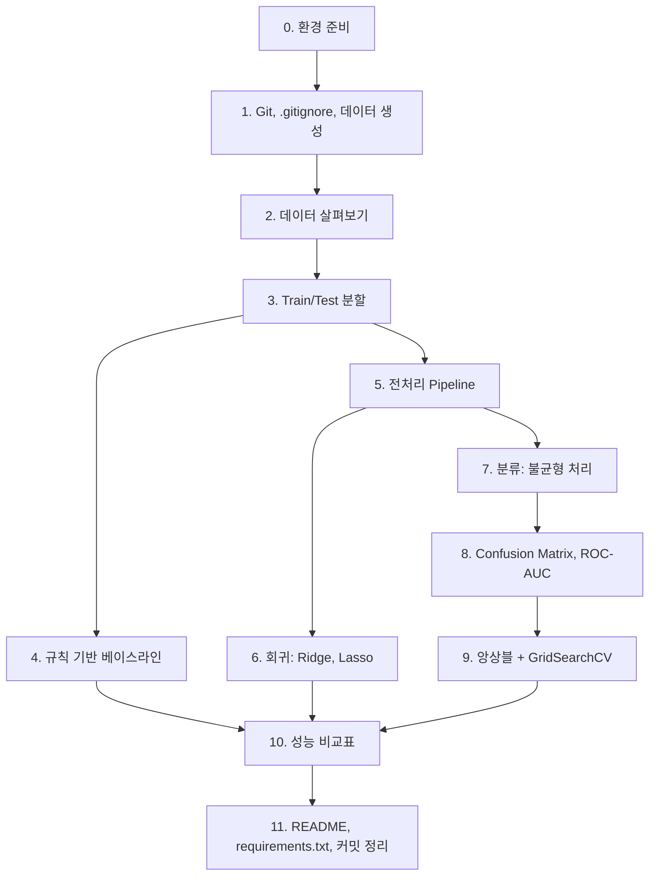

# A5-1 단계별 실습 가이드 — 대출 심사 AI: 규칙 기반 vs 머신러닝(회귀/분류)

과제 원문: [../subject.md](../subject.md)<br>
개념 설명: [LEARNING_GUIDE.md](LEARNING_GUIDE.md)

이 문서는 환경 준비부터 제출까지 **무엇을 어떤 순서로 만들지** 안내합니다. 완성 코드는 제공하지 않습니다. 각 단계는 목표 / 할 일 / 힌트 / 확인 방법으로 구성되어 있고, 확인 방법(체크포인트)을 통과한 뒤 다음 단계로 넘어가는 것을 권장합니다. 개념이 막히면 각 단계에 연결된 LEARNING_GUIDE 장을 먼저 읽으세요.

## 전체 흐름



## 최종 산출물 체크리스트(과제 원문 기준)

| 산출물 | 근거 |
| --- | --- |
| `data_gen.py` (제공 코드 그대로) 와 실행으로 생성된 `finance_data.csv` | 4-1 |
| `.gitignore` 에 `*.csv` 포함 | 4-1 |
| 규칙 기반 베이스라인(규칙 5개 이상) + Accuracy/Precision/Recall/F1 | 4-2 |
| Pipeline/ColumnTransformer 전처리(수치형: 대치→스케일링, 범주형: 인코딩) | 4-3 |
| Ridge, Lasso + Alpha(0.01, 0.1, 1, 10, 100)별 계수 변화 그래프 | 2-2, 4-4 |
| 회귀 지표 RMSE/MAE/R² 중 2개 이상 + 비교표 | 2-2, 4-4 |
| 분류: 불균형 처리, 연체 확률(0~1), Confusion Matrix 시각화, ROC 곡선 + AUC 값 | 2-3, 4-4 |
| Random Forest 또는 XGBoost + GridSearchCV | 4-4 |
| README.md: 개요, 실행 방법, 성능 비교 리포트(베이스라인 vs ML 비교표 포함) | 2-4, 4-2 |
| requirements.txt: 라이브러리와 버전 | 2-4, 7 |
| 기능 단위(전처리, 모델링, 문서화) 커밋 로그 | 7 |

과제는 노트북(.ipynb)이든 스크립트(.py)든 형식을 강제하지 않습니다. 결과 예시에도 "레포지토리 구조는 달라도 된다"고 되어 있습니다. 아래는 하나의 **권장** 구조입니다.

```text
A5-1/
├── .gitignore
├── README.md
├── requirements.txt
├── data_gen.py
├── finance_data.csv          # 생성됨, Git에는 올라가지 않음
├── analysis.ipynb            # 또는 여러 .py 파일 (보너스 2 참고)
└── images/                   # 그래프 저장 위치(권장)
```

## 0단계. 환경 준비

**목표**: Python 3.10 이상과 허용된 라이브러리만으로 작업할 환경을 만든다.

**할 일**

1. Python 버전을 확인한다.
2. 프로젝트 폴더에 가상환경을 만들고 활성화한다.
3. 필수 라이브러리(scikit-learn, pandas, numpy, matplotlib 또는 seaborn)를 설치한다. 노트북을 쓴다면 Jupyter도 설치한다.
4. SMOTE를 쓸 계획이면 `imbalanced-learn`, XGBoost를 쓸 계획이면 `xgboost`를 설치한다(선택).

**힌트**

```bash
python3 --version
python3 -m venv .venv
source .venv/bin/activate        # Windows: .venv\Scripts\activate
```

- PyTorch, TensorFlow 같은 딥러닝 프레임워크는 **사용 금지**입니다.
- 가상환경 폴더(`.venv/`)도 `.gitignore`에 넣는 것을 권장합니다.

**확인 방법**: `python -c "import sklearn, pandas, numpy, matplotlib; print(sklearn.__version__)"`가 오류 없이 버전을 출력한다.

## 1단계. Git 저장소, .gitignore, 데이터 생성

**목표**: 데이터를 만들고, CSV가 저장소에 올라가지 않게 설정한다. 개념: [LEARNING_GUIDE 17장](LEARNING_GUIDE.md#17-재현성과-형상-관리)

**할 일**

1. `git init`
2. `.gitignore`를 만들고 `*.csv`를 추가한다.
3. 과제 원문 4장의 [데이터 생성 코드](../subject.md)를 **그대로** `data_gen.py`로 저장하고 실행한다.
4. 첫 커밋을 만든다(`data_gen.py`, `.gitignore`).

**힌트**

- 생성 코드는 의도적으로 노이즈와 불균형을 넣었습니다. 코드나 CSV를 임의로 수정하지 마세요. 주석에는 "음수를 0으로 처리"라고 되어 있지만 실제 코드는 소득을 최소 1500으로 맞춥니다. 이것도 수정하지 않습니다.
- 반드시 `.gitignore`를 **먼저** 만든 뒤 `git add`하세요. 순서를 바꾸면 CSV가 이미 추적되어 무시되지 않습니다.

**확인 방법**

- 실행 출력에 `전체 샘플 수: 10000`과 연체 비율(약 12% 내외)이 찍힌다.
- `git status`에 `finance_data.csv`가 나타나지 않는다.
- `git check-ignore -v finance_data.csv`가 `.gitignore`의 규칙을 출력한다.

## 2단계. 데이터 살펴보기(EDA, 권장)

**목표**: 모델을 만들기 전에 열, 분포, 불균형을 눈으로 확인한다. 개념: [LEARNING_GUIDE 1장](LEARNING_GUIDE.md#1-지도학습-특성과-타깃-회귀와-분류)

**할 일**

1. CSV를 읽고 `shape`, `dtypes`, `isna().sum()`, `describe()`를 확인한다.
2. `is_overdue`의 비율(`value_counts(normalize=True)`)을 확인한다.
3. 특성 6개와 타깃 2개를 변수로 분리해 둔다.

**힌트**

- 결측치가 0개이고 모든 열이 숫자형이라는 것을 확인하게 됩니다. 이 사실은 5단계(대치, 인코딩 설계)에서 중요합니다.
- 특성 목록을 상수로 만들어 두면 이후 단계에서 실수가 줄어듭니다.

```python
FEATURES = ["age", "annual_income", ...]   # TODO: 6개
TARGET_REG = "credit_score"
TARGET_CLF = "is_overdue"
```

**확인 방법**: `(10000, 8)`, 결측치 0, 연체 비율이 1단계 출력과 같다. 특성 목록에 `credit_score`와 `is_overdue`가 **없다**.

## 3단계. Train/Test 분할

**목표**: 8:2 층화 분할을 `random_state=42`로 고정한다. 개념: [LEARNING_GUIDE 3장](LEARNING_GUIDE.md#3-데이터-분할-층화-재현성-교차-검증)

**할 일**

1. `train_test_split`으로 X, 회귀 타깃, 분류 타깃을 **한 번에** 나눈다(같은 고객이 같은 쪽에 가도록).
2. `test_size=0.2`, `random_state=42`, `stratify=분류 타깃`을 지정한다.

**힌트**

```python
X_train, X_test, yr_train, yr_test, yc_train, yc_test = train_test_split(
    X, y_reg, y_clf, test_size=..., random_state=..., stratify=...)
```

- 회귀와 분류를 따로 나누면 두 모델의 Test 고객이 달라져 비교 해석이 어려워집니다(권장: 한 번에 분할).

**확인 방법**: `len(X_train) == 8000`, `len(X_test) == 2000`, `yc_train.mean()`과 `yc_test.mean()`이 거의 같다.

## 4단계. 규칙 기반 베이스라인

**목표**: if-else 규칙 5개 이상으로 연체를 예측하고 Accuracy, Precision, Recall, F1을 측정한다. 개념: [LEARNING_GUIDE 2장](LEARNING_GUIDE.md#2-규칙-기반-베이스라인), [10장](LEARNING_GUIDE.md#10-분류-지표와-confusion-matrix)

**할 일**

1. `rule_based_predict(row)` 함수를 만든다. 규칙은 **최소 5개**.
2. Test Set 각 행에 적용해 예측 배열을 만든다.
3. 네 가지 지표를 계산한다.
4. 비교표에 AUC 열을 넣으려면 AUC 계산 방식을 정한다.

**힌트**

- 과제 원문 8장의 예시 함수는 규칙이 4개입니다. 그대로 쓰면 개수 요건을 채우지 못합니다.
- 기준값(0.7, 3000 등)은 Train Set만 보고 정하세요. Test를 보고 기준값을 조정하면 규칙 모델에도 누수가 생깁니다.
- `df.apply(rule_based_predict, axis=1)`로 행 단위 적용이 가능합니다.
- 지표 함수: `accuracy_score`, `precision_score`, `recall_score`, `f1_score` (`sklearn.metrics`).
- AUC: 0/1 예측으로 `roc_auc_score`를 계산하거나, "걸린 규칙 수"를 위험 점수로 써서 계산할 수 있습니다. 어느 방식인지 README에 적으세요.

**확인 방법**

- 규칙이 5개 이상인지 세어 본다.
- 예측 1의 비율을 확인한다. 거의 모두 1이거나 거의 모두 0이면 규칙 기준값을 다시 검토한다.
- `precision_score`가 경고(UndefinedMetricWarning)를 내지 않는다(예측 1이 0건이면 경고가 난다).

**커밋 예**: `feat: 규칙 기반 베이스라인과 지표 측정`

## 5단계. 전처리 Pipeline 설계

**목표**: ColumnTransformer로 수치형은 대치→스케일링, 범주형은 인코딩이 되도록 모듈화한다. 개념: [LEARNING_GUIDE 5장](LEARNING_GUIDE.md#5-전처리-대치-스케일링-인코딩), [6장](LEARNING_GUIDE.md#6-pipeline과-columntransformer)

**할 일**

1. 수치형 열 목록과 범주형 열 목록을 정한다.
2. 수치형 파이프라인: `SimpleImputer` → `StandardScaler`
3. 범주형 파이프라인: (필요하면 `SimpleImputer(strategy="most_frequent")`) → `OneHotEncoder`
4. 둘을 `ColumnTransformer`로 묶은 `build_preprocessor()` 같은 함수를 만든다. 회귀와 분류에서 재사용한다.

**힌트**

- 이 데이터에는 문자열 범주 열이 없습니다. 어떤 열을 범주형으로 취급할지 정하고 근거를 README에 적어야 합니다. 선택지는 [LEARNING_GUIDE 5.3](LEARNING_GUIDE.md#53-범주형-인코딩encoding)에 정리되어 있습니다.
- `OneHotEncoder(handle_unknown="ignore")`를 권장합니다.
- 전처리기는 아직 fit하지 않습니다. 모델과 함께 Pipeline에 넣어 Train으로만 fit되게 합니다.

```python
def build_preprocessor(num_cols, cat_cols):
    # TODO: numeric pipeline, categorical pipeline, ColumnTransformer
    pass
```

**확인 방법**

- 임시로 `prep = build_preprocessor(...)`; `prep.fit(X_train)`; `prep.transform(X_test).shape`를 찍어 열 수가 예상(수치형 개수 + 원-핫 열 개수)과 같은지 본다.
- `prep.get_feature_names_out()`으로 변환 후 열 이름을 확인한다. 7~9단계 그래프 라벨에 사용한다.
- 코드 어디에도 `X_test`나 전체 `X`에 대한 `fit`/`fit_transform` 호출이 없다.

**커밋 예**: `feat: ColumnTransformer 전처리 파이프라인`

## 6단계. 회귀 모델: Ridge, Lasso와 Alpha별 계수 변화

**목표**: `credit_score`를 예측하고, Alpha 5개 값에서 계수 변화를 그래프로 보여 준다. 개념: [LEARNING_GUIDE 7장](LEARNING_GUIDE.md#7-선형-회귀와-회귀-지표), [8장](LEARNING_GUIDE.md#8-과대적합과-규제ridge-lasso)

**할 일**

1. `alphas = [0.01, 0.1, 1, 10, 100]`
2. 각 Alpha마다 `Pipeline([전처리, Ridge(alpha=a)])`를 Train으로 학습하고 마지막 단계의 `coef_`를 저장한다. Lasso도 같게 반복한다.
3. Ridge, Lasso 각각 계수 변화 그래프를 그린다(x축 Alpha 로그 눈금, 선 하나가 변수 하나, 범례에 변수명).
4. Test Set으로 RMSE, MAE, R² 중 2개 이상을 계산하고 비교표를 만든다.
5. 예측값이 0~1000 범위인지 확인한다.

**힌트**

- 학습된 Pipeline의 모델은 `pipe.named_steps["단계이름"].coef_` 또는 `pipe[-1].coef_`로 꺼냅니다.
- 계수 기록은 `DataFrame(index=alphas, columns=feature_names)` 모양으로 모으면 `df.plot(logx=True)` 한 줄로 그릴 수 있습니다.
- RMSE: `np.sqrt(mean_squared_error(...))`. scikit-learn 버전에 따라 `root_mean_squared_error`가 따로 있을 수도 있습니다.
- 범위 제한: `np.clip(pred, 0, 1000)`. 적용했다면 README에 적습니다.
- 그래프는 `plt.savefig("images/...png", dpi=150, bbox_inches="tight")`로 파일로도 남기면 README에 넣기 쉽습니다(권장).
- 비교표에 어떤 Alpha의 결과를 넣을지 정해야 합니다. 원문 예시는 Alpha=1이지만, CV로 Alpha를 고르는 방법(`RidgeCV`, `LassoCV` 또는 GridSearchCV)도 있습니다(권장).

**확인 방법**

- Lasso 그래프에서 `age`, `spending_score`, `credit_card_count` 계수가 작은 Alpha부터 0에 붙어 있다. 생성 코드상 점수와 무관한 변수이기 때문이다.
- Lasso Alpha=100에서 계수가 대부분 또는 모두 0이 되고 R²가 크게 떨어진다.
- Ridge 그래프가 이 범위에서 거의 평평해도 정상이다. 왜 그런지 한 문장으로 설명할 수 있는지 스스로 확인한다.
- 좋은 Alpha에서 RMSE는 노이즈 크기(30) 근처, R²는 0.8 이상 수준이 나온다. 터무니없이 높으면(예: R² 0.999) 특성에 타깃이 섞였는지 의심한다.

**커밋 예**: `feat: Ridge/Lasso 회귀와 Alpha별 계수 그래프`

## 7단계. 분류 모델과 불균형 처리

**목표**: `is_overdue`의 연체 확률(0~1)을 출력하는 모델을 만들고 불균형을 처리한다. 개념: [LEARNING_GUIDE 9장](LEARNING_GUIDE.md#9-로지스틱-회귀와-확률), [12장](LEARNING_GUIDE.md#12-데이터-불균형-class_weight와-smote)

**할 일**

1. 기본 분류 모델로 `LogisticRegression`을 Pipeline에 넣는다(원문 비교표 예시의 두 번째 행).
2. 불균형 처리를 적용한다: `class_weight="balanced"` **또는** SMOTE.
3. `predict_proba(X_test)[:, 1]`로 연체 확률을 얻는다.
4. Accuracy, Precision, Recall, F1, AUC를 계산한다.

**힌트**

- 효과를 보이려면 불균형 처리 **전/후**를 한 번씩 학습해 Recall, F1 변화를 비교하면 좋습니다(권장).
- SMOTE를 쓴다면 `imblearn.pipeline.Pipeline`을 쓰고 순서는 `전처리 → SMOTE → 모델`입니다. 분할 전 전체 데이터에 SMOTE를 적용하면 안 됩니다.
- `LogisticRegression`이 수렴 경고를 내면 `max_iter`를 늘립니다. 스케일링이 빠졌는지도 확인하세요.

**확인 방법**

- 확률의 최솟값과 최댓값이 0 이상 1 이하이다.
- 불균형 처리 후 Recall이 처리 전보다 오른다. Accuracy는 떨어져도 이상하지 않다.
- `yc_test.mean()`과 `(pred == 1).mean()`을 비교해 모델이 연체를 얼마나 많이 예측하는지 감을 잡는다.

## 8단계. Confusion Matrix와 ROC-AUC 시각화

**목표**: 분류 결과를 그림으로 남기고 AUC 값을 명시한다. 개념: [LEARNING_GUIDE 10장](LEARNING_GUIDE.md#10-분류-지표와-confusion-matrix), [11장](LEARNING_GUIDE.md#11-임계값-roc-곡선-auc)

**할 일**

1. Confusion Matrix를 시각화한다.
2. ROC 곡선을 그리고 AUC 값을 그래프 안(범례나 제목)에 표시한다.
3. 여러 모델(베이스라인, Logistic, 앙상블)의 ROC를 한 그림에 겹쳐 그리면 비교가 쉽다(권장).

**힌트**

```python
from sklearn.metrics import ConfusionMatrixDisplay, RocCurveDisplay
ConfusionMatrixDisplay.from_predictions(y_true, y_pred)
RocCurveDisplay.from_predictions(y_true, y_score, name="...")   # y_score는 확률
```

- 여러 곡선을 겹치려면 `ax`를 만들어 각 호출에 `ax=ax`를 넘깁니다.
- 대각선(무작위 기준선)을 함께 그리면 해석이 쉬워집니다.

**확인 방법**

- Confusion Matrix의 네 칸 합이 2000이다. 아래 행(실제 1)의 합이 Test의 연체 건수와 같다.
- ROC 범례나 제목에 `AUC = 0.xx`가 보인다.
- ROC 곡선이 계단이 아니라 꺾인 선 하나뿐이라면 확률 대신 0/1을 넣은 것이다.

**커밋 예**: `feat: 분류 모델, 불균형 처리, CM/ROC 시각화`

## 9단계. 앙상블 + GridSearchCV

**목표**: Random Forest 또는 XGBoost를 GridSearchCV로 튜닝한다. 개념: [LEARNING_GUIDE 13장](LEARNING_GUIDE.md#13-결정-트리-random-forest-xgboost), [14장](LEARNING_GUIDE.md#14-gridsearchcv)

**할 일**

1. `Pipeline([전처리, RandomForestClassifier(random_state=42, class_weight=...)])`를 만든다.
2. `param_grid`를 정한다. 파라미터당 후보 5개 이하, 총 조합 100개 이하(권장 기준).
3. `GridSearchCV(pipe, param_grid, cv=5, scoring=..., n_jobs=-1)`을 **Train으로만** fit한다.
4. `best_params_`, `best_score_`를 기록하고 `best_estimator_`로 Test를 평가한다.
5. 8단계와 같은 방식으로 Confusion Matrix와 ROC를 만든다.
6. (권장) `feature_importances_`를 막대그래프로 그리고 해석 3줄을 쓴다.

**힌트**

- 파라미터 이름은 `단계이름__파라미터`입니다(밑줄 두 개). 예: `"clf__max_depth"`.
- 조합 수는 각 후보 개수의 곱입니다. 손으로 계산해 100을 넘지 않는지 확인하세요.
- 처음에는 작은 그리드로 실행 시간을 확인한 뒤 늘립니다.
- 이 앙상블 모델은 다음 과제 A5-2의 SHAP 해석 대상이 됩니다. A5-2는 XGBoost를 금지하고 scikit-learn 내장 모델만 허용하므로, Random Forest를 고르면 A5-2로 이어 가기가 수월합니다(권장).

**확인 방법**

- `len(grid.cv_results_["params"])`가 예상 조합 수와 같다.
- `best_score_`(CV)와 Test 점수가 크게 다르지 않다. 차이가 크면 과대적합이나 누수를 의심한다.
- 중요도 상위에 `overdue_count_6m`, `annual_income`, `debt_ratio` 같은 변수가 오는지 본다. 생성 코드와 연결해 해석할 수 있다.

**커밋 예**: `feat: Random Forest GridSearchCV 튜닝`

## 10단계. 성능 비교표 만들기

**목표**: 베이스라인 vs ML 모델 비교표와 회귀 비교표를 만든다.

**할 일**

1. 분류 비교표: 행 = 규칙 기반, Logistic Regression, 앙상블(튜닝). 열 = 최소 Accuracy, F1-Score, AUC(최종 결과물 1). Precision, Recall도 넣는 것을 권장.
2. 회귀 비교표: 행 = Ridge, Lasso(선택한 Alpha 명시). 열 = RMSE, MAE, R² 중 2개 이상.
3. 베이스라인 대비 향상률을 계산한다(원문 README 예시 참고).

**힌트**

- 결과를 dict 리스트로 모은 뒤 `pd.DataFrame(...).round(3)`으로 만들면 `to_markdown()`으로 README에 붙이기 쉽습니다(`to_markdown`은 `tabulate` 패키지가 필요하므로, 허용 라이브러리 범위를 지키려면 손으로 옮기는 편이 안전합니다).
- 향상률 $= (\text{ML} - \text{베이스라인}) / \text{베이스라인} \times 100$.

**확인 방법**: 모든 숫자가 **같은 Test Set(2,000건)** 에서 계산되었다.

## 11단계. README.md, requirements.txt, 커밋 정리

**목표**: 다른 사람이 저장소만 보고 실행하고 결과를 이해할 수 있게 한다.

**할 일**

1. `README.md`에 최소한 다음을 쓴다.
   - 프로젝트 개요
   - 실행 방법(가상환경 → 설치 → `python data_gen.py` → 분석 실행)
   - 성능 비교 리포트: 분류 비교표(베이스라인 vs ML), 회귀 비교표, 그래프(계수 변화, CM, ROC)
   - 설계 결정: 범주형 처리 방식, 불균형 처리 방식, 베이스라인 AUC 계산 방식, 선택한 Alpha
   - (권장) Feature Importance 그래프와 해석 3줄
2. `requirements.txt`에 실제 설치 버전을 적는다. imbalanced-learn, XGBoost를 썼다면 반드시 포함한다.
3. `git log --oneline`으로 커밋이 기능 단위로 나뉘었는지 확인한다.
4. 새 폴더에 저장소를 clone해서 README 순서대로 실행해 본다(권장).

**힌트**

- `pip freeze`는 모든 하위 의존성까지 출력합니다. 직접 쓴 라이브러리만 골라 적어도 됩니다.
- 그래프 이미지는 ``로 README에 넣습니다. 이미지 파일은 `.gitignore`의 `*.csv`에 걸리지 않으므로 커밋됩니다.

**확인 방법**: 새로 clone한 폴더에 `finance_data.csv`가 없고, `python data_gen.py` 후 분석이 끝까지 실행된다.

**커밋 예**: `docs: README 성능 비교 리포트 작성`

## 자주 막히는 지점

| 증상 | 원인 | 해결 |
| --- | --- | --- |
| 분류 AUC가 0.99 이상 | 특성에 `credit_score`나 `is_overdue`가 포함됨 | 특성 목록을 6개로 제한 |
| `git status`에 CSV가 보임 | `.gitignore`보다 먼저 `git add`함 | `git rm --cached finance_data.csv` 후 재커밋 |
| ROC가 꺾인 선 하나 | 확률 대신 `predict()` 결과 사용 | `predict_proba()[:, 1]` |
| GridSearchCV `Invalid parameter` 오류 | `clf__`처럼 단계 이름 접두어 누락, 또는 밑줄 1개 | 단계 이름과 `__` 확인 |
| SMOTE를 Pipeline에 넣으니 오류 | scikit-learn Pipeline 사용 | `imblearn.pipeline.Pipeline` 사용 |
| Ridge 계수 그래프가 평평함 | 샘플 수 대비 Alpha가 작음(정상) | README에 이유를 해석해 적기 |
| Lasso Alpha=100에서 R²≈0 | 모든 계수가 0이 됨(정상) | 과소적합 사례로 해석 |
| 실행할 때마다 숫자가 바뀜 | `random_state` 누락(분할, 모델, SMOTE, CV) | 모든 무작위 요소에 42 지정 |
| `precision_score` 경고 | 예측 1이 하나도 없음 | 규칙/임계값 점검 |

## 최종 자기 점검표

| 요구사항(subject.md) | 어디서 확인하는지 |
| --- | --- |
| 제공 코드를 `data_gen.py`로 저장, 실행해 CSV 생성 | 저장소의 `data_gen.py`가 원문과 동일, 실행 출력 10000건 |
| 데이터 임의 수정 금지 | 코드 어디에도 CSV를 덮어쓰거나 행을 바꾸는 부분이 없음 |
| `git init` + `.gitignore`로 `*.csv` 제외 | `git ls-files`에 `.csv` 없음 |
| 규칙 5개 이상의 if-else 베이스라인 | `rule_based_predict` 함수의 규칙 개수 |
| 베이스라인 Accuracy/Precision/Recall/F1 | 노트북 출력, README 비교표 |
| 베이스라인 vs ML 비교표(Accuracy, F1, AUC)가 README에 | README 성능 비교 섹션 |
| Pipeline 또는 ColumnTransformer로 전처리 모듈화 | `build_preprocessor` 등 전처리 코드 |
| 수치형 대치→스케일링, 범주형 인코딩 | ColumnTransformer 구성, README 설계 결정 |
| 스케일러/인코더/SMOTE fit은 Train에서만 | `fit` 호출 대상이 모두 Train 또는 Pipeline/GridSearchCV(Train 입력) |
| 8:2 분할, `random_state=42` | `train_test_split` 호출 인자 |
| (권장) stratified split, 5-fold CV | `stratify=`, `cv=5` |
| Ridge와 Lasso 모두 적용 | 회귀 코드 |
| Alpha 0.01, 0.1, 1, 10, 100별 계수 변화 그래프 | 계수 그래프 이미지(Ridge, Lasso) |
| RMSE/MAE/R² 중 2개 이상 + 비교표 | README 회귀 비교표 |
| 0~1000 범위 신용 점수 예측값 | 예측값 범위 출력(필요 시 clip) |
| `class_weight='balanced'` 또는 SMOTE | 분류 모델 생성 코드 |
| 연체 확률(0~1) 출력 | `predict_proba` 결과 |
| Confusion Matrix 시각화 | CM 이미지 |
| ROC 곡선 + AUC 값 명시 | ROC 이미지의 범례/제목 |
| RF 또는 XGBoost + GridSearchCV | GridSearchCV 코드, `best_params_` 출력 |
| (권장) 조합 100개 이하, 파라미터당 후보 5개 이하 | `cv_results_` 길이 |
| (권장) Feature Importance 시각화 + 해석 3줄 | README |
| README: 개요, 실행 방법, 성능 비교 리포트 | README 목차 |
| requirements.txt + 선택 라이브러리 버전 | `requirements.txt` |
| 허용 라이브러리만 사용, 딥러닝 프레임워크 미사용 | import 목록 |
| 외부 데이터 미사용 | 데이터 로드 코드 |
| Python 3.10 이상 | `python --version` |
| 기능 단위 커밋(전처리, 모델링, 문서화) | `git log --oneline` |

## 보너스 과제(선택) — 힌트만

### 보너스 1. Custom Transformer

- `BaseEstimator`, `TransformerMixin`을 상속하고 `fit`은 `self`를 반환, `transform`은 변환 결과를 반환합니다. 구조는 [LEARNING_GUIDE 16장](LEARNING_GUIDE.md#16-커스텀-transformer보너스) 참고.
- 파생 변수 아이디어를 고를 때는 "CSV는 수정하지 않고 Pipeline 안에서만 만든다"를 지킵니다.
- 만든 클래스를 ColumnTransformer 앞이나 안에 넣고, GridSearchCV가 `clone`할 수 있는지(`__init__` 인자 그대로 저장) 확인합니다.
- 확인: `sklearn.base.clone(내_변환기)`가 오류 없이 동작하고, Pipeline 전체 성능이 출력된다.

### 보너스 2. 모듈화

- 노트북 셀을 역할별 파일로 나눕니다. 예(권장): `preprocess.py`(전처리기 생성), `baseline.py`, `train_regression.py`, `train_classification.py`, `main.py`.
- 각 파일의 실행 코드는 `if __name__ == "__main__":` 아래에 둡니다.
- 확인: 새 터미널에서 `python main.py` 하나로 결과 표와 그래프가 다시 만들어진다.

### 보너스 3. Learning Curve

- `sklearn.model_selection.learning_curve`에 Pipeline, Train Set, `cv=5`, `train_sizes`를 넘깁니다.
- 반환된 Train 점수와 Validation 점수의 fold 평균을 선 두 개로 그립니다.
- 해석은 [LEARNING_GUIDE 15장](LEARNING_GUIDE.md#15-편향-분산과-learning-curve보너스)의 표를 기준으로 "과소적합/과대적합 중 어느 쪽인가, 데이터를 늘리면 나아질까"를 쓰면 됩니다.
